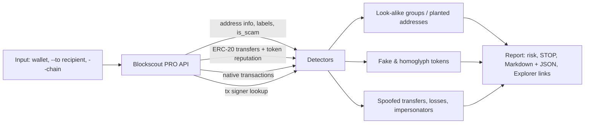

# Scam Address Checker

Detects **address poisoning** around a wallet using the **Blockscout PRO API**, and checks a recipient address *before* you send funds.

Address poisoning is a scam where an attacker creates an address with the same first and last characters as one you use, then plants it in your history (zero-value transfers, fake tokens with look-alike names, transfers you never signed). Wallets show only `0x1234…abcd`, so victims copy the wrong address. Researchers counted hundreds of millions of poisoning attempts on Ethereum and BNB Chain between 2022 and 2024.

## What it finds
| Signal | How |
|---|---|
| Look-alike counterparties | groups every address the wallet interacted with by visible prefix + suffix |
| Planted addresses | an address that first appears through a fake-token, zero-value or spoofed transfer |
| Fake tokens | homoglyph symbols (`WВТC` with Cyrillic letters), copies of USDT/USDC/WBTC/WETH/DAI at non-canonical contracts, ERC-20s named `ETH`, Blockscout scam reputation |
| Spoofed history | transfers where the wallet appears as sender but the transaction was signed by someone else |
| Losses | real value later sent to a planted address |
| Impersonators | addresses that copy the **wallet's own** prefix/suffix, used to trick people who pay this wallet |
| Recipient check | `--to <address>` returns **STOP** with reasons: Blockscout scam flag, planted in your history, or a look-alike you never used |

Every finding links to **Blockscout Explorer** as evidence.

## Real case: May 2024, 1,155 WBTC lost
```
python checker.py 0x1E227979f0b5BC691a70DEAed2e0F39a6F538FD5 --to 0xd9A1C3788D81257612E2581A6ea0aDa244853a91
Risk HIGH: 2 lookalike groups, 4 fake tokens, 3 spoofed transfers.
```
The report shows the fake `WВТC` token, the planted look-alikes `0xd9A1C378…3a91` and `0xD9A19256…3a91`, the spoofed transfers signed by other addresses, the real WBTC sent to the planted address, and **STOP** for the recipient. A busy clean wallet (`vitalik.eth`) returns `Risk NONE` on Ethereum, while on Optimism the same wallet returns `Risk MEDIUM`: two addresses that imitate `0xd8dA…6045` itself interacted with it (`--chain 10`).

## Demo
3-minute walkthrough: [demo/demo.mp4](demo/demo.mp4) (rebuild with `python demo/make_demo.py`).

## Architecture

Blockscout is the only data source: no node and no indexer of our own.

## Run
```
python -m pip install -r requirements.txt
copy .env.example to .env and paste your key (or set the BLOCKSCOUT_API_KEY environment variable)
python checker.py <address> [--chain 1] [--to <recipient>] [--pages 10]
```
Output: `reports/<chain>_<address>.md` (human report) and `.json` (machine-readable).
Get a free key at https://dev.blockscout.com (100K credits/day). Without a key the tool uses the public Blockscout instance (development only).
Multichain: one PRO key, chain chosen with `--chain`. Tested on the free plan: Ethereum (1), Optimism (10), Arbitrum (42161), Gnosis (100). Featured chains such as Base (8453) and Polygon (137) need a paid PRO plan; the tool says so instead of failing silently.

The key is sent in the `Authorization` header, never in the URL, so it does not appear in logs.

## Blockscout API endpoints used
- `GET /api/v2/addresses/{address}`: labels, scam flag, ENS
- `GET /api/v2/addresses/{address}/token-transfers?type=ERC-20`: transfers with token reputation (paginated)
- `GET /api/v2/addresses/{address}/transactions`: native transfers
- `GET /api/v2/transactions/{hash}`: who actually signed a suspicious transfer

## Roadmap
- Web UI with a one-click "check before sending" box
- Watch mode: alert (Telegram) when a new look-alike is planted in your history
- Cross-chain view: the same attacker across chains via one PRO API key

## Disclaimer
Heuristics, not proof. Use the linked on-chain evidence to verify. Never interact with addresses or tokens flagged here.

License: MIT
